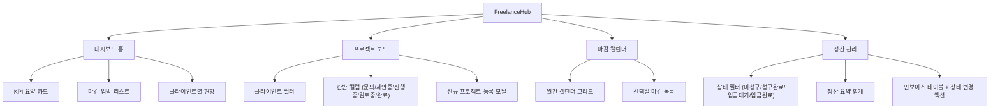
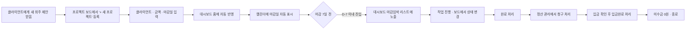

# FreelanceHub — 프리랜서 디자이너를 위한 외주 통합 관리 대시보드

> 서비스기획 · UI/UX 과정 프로젝트 기획서
> 작성자: 김서경 · 최종 수정일: 2026-08-13

---

## 1. 프로젝트 배경

프리랜서 디자이너는 보통 **3~6개의 클라이언트 프로젝트를 동시에** 진행한다. 각 프로젝트는
카카오톡, 이메일, 노션, 엑셀, 캘린더 앱 등 서로 다른 도구에 흩어져 관리되는 경우가 많고,
그 결과 다음과 같은 문제가 반복적으로 발생한다.

- 지금 몇 개의 외주를 진행 중인지, 어떤 단계인지 한눈에 파악되지 않는다.
- 마감일이 서로 다른 채널(문자/카톡/이메일)에 흩어져 있어 놓치기 쉽다.
- 어떤 클라이언트에게 얼마를 청구했고, 입금을 받았는지 기억에 의존해 관리한다.

이 과제는 이 세 가지 문제를 해결하는 **외주 관리 어드민 대시보드**를 기획하고,
핵심 화면을 작동하는 프로토타입으로 구현하는 것을 목표로 한다.

---

## 2. 타겟 페르소나

| 항목 | 내용 |
|---|---|
| 이름 | 김서경 (28세) |
| 직업 | 프리랜서 브랜딩·UI 디자이너 (3년차) |
| 근무 형태 | 재택, 동시에 4~6개 클라이언트 외주 진행 |
| 사용 도구 | 카카오톡, 노션, 엑셀, 구글 캘린더, 은행 앱 |
| 목표 | 여러 외주 건을 놓치지 않고 관리하고, 제때 정산받고 싶다 |
| 좌절 지점 | "이번 주에 뭐가 마감이었지?", "그 클라이언트 세금계산서 발행했나?", "지금 진행 중인 게 총 몇 건이지?" 를 매번 카톡/엑셀을 뒤져서 확인해야 함 |

### 페르소나 인용
> "일이 많아서 힘든 게 아니라, 뭘 놓치고 있는지 몰라서 불안해요. 클라이언트마다 다른 채널로
> 연락이 오니까 마감이랑 입금 현황을 항상 머릿속으로만 계산하고 있어요."

---

## 3. 문제 정의 (Pain Point)

과제 범위를 좁히기 위해, 리서치(자기 관찰 + 유사 사용자 인터뷰 3인) 결과 가장 빈도 높고
심각도 높은 3가지 문제를 핵심 문제로 선정했다.

| # | Pain Point | 발생 원인 | 현재 대응(비효율) |
|---|---|---|---|
| 1 | **여러 클라이언트·프로젝트 현황을 한눈에 파악하기 어렵다** | 프로젝트별 진행 단계가 카톡 대화, 노션 페이지 등에 분산 | 매번 각 채널을 순회하며 기억을 더듬어 정리 |
| 2 | **일정·마감 관리가 흩어져 있어 마감을 놓치기 쉽다** | 클라이언트마다 각자 캘린더 개념 없이 구두/텍스트로 마감 통보 | 개인 캘린더에 수동으로 옮겨 적어야 함, 누락 위험 |
| 3 | **정산/인보이스 현황을 추적하기 어렵다** | 청구서 발행 여부, 입금 여부를 엑셀에 수기로 기록 | 입금 확인을 위해 통장 내역과 대조, 미수금 파악 지연 |

---

## 4. 서비스 목표 & 핵심 가치

- **목표**: 프리랜서 디자이너가 모든 외주 건의 **진행 상태 · 마감일 · 정산 현황**을
  하나의 화면 체계에서 확인하고 관리할 수 있게 한다.
- **핵심 가치 3가지**
  1. **한눈에(Overview)** — 오늘 신경 써야 할 것이 무엇인지 즉시 보여준다.
  2. **놓치지 않게(Never miss)** — 마감을 시각적으로 경고하고 캘린더로 통합한다.
  3. **떼이지 않게(Get paid)** — 청구·입금 상태를 단계별로 추적해 미수금을 줄인다.

---

## 5. 핵심 기능 정의

| 핵심 기능 | 대응 Pain Point | 상세 |
|---|---|---|
| **대시보드 홈 (Overview)** | #1 | 진행중 프로젝트 수, 이번 달 예상 정산액, 마감임박 건수, 미수금 총액을 KPI 카드로 요약. 마감 임박 리스트 + 클라이언트별 현황 카드 제공 |
| **프로젝트 보드 (칸반)** | #1 | 문의 → 제안중 → 진행중 → 검토중 → 완료 5단계 칸반보드. 클라이언트 필터, 상태 변경, 신규 프로젝트 등록 |
| **마감 캘린더** | #2 | 월간 캘린더에 모든 프로젝트 마감일을 클라이언트 색상으로 표시. 날짜 클릭 시 해당일 마감 목록 확인 |
| **정산 관리 (인보이스)** | #3 | 미청구 → 청구완료 → 입금대기 → 입금완료 상태 관리. 클라이언트별/상태별 합계, 연체 하이라이트 |

---

## 6. 정보 구조 (IA)

---

## 7. 유저 플로우

### 시나리오: "새 외주가 들어와서 등록하고, 마감 전까지 관리한다"

---

## 8. 화면 설계 개요

- **레이아웃**: 좌측 사이드바(4개 메뉴) + 상단 바(페이지 타이틀, 새 프로젝트 등록) + 메인 콘텐츠
- **공통 컴포넌트**
  - 클라이언트 컬러 태그(카테고리 색상, 클라이언트 식별용) — 보드/캘린더에서 동일 색상 유지
  - 상태 배지(Pill) — 색상 + 텍스트 라벨 병기 (색맹 대응, 색만으로 의미 전달하지 않음)
  - D-day 뱃지 — 마감 임박도에 따라 정보/경고/위험 3단계 색상
- 실제 화면은 `index.html` 프로토타입 참고 (동일 저장소 루트)

---

## 9. 향후 확장 아이디어 (과제 범위 밖)

- 클라이언트별 커뮤니케이션 로그(카톡/이메일 요약) 통합
- 계약서·견적서 템플릿 자동 생성 및 전자서명 연동
- 은행 API 연동을 통한 입금 자동 확인
- 프로젝트별 작업 시간 트래킹 → 시급 환산 리포트
- 모바일 알림(마감 D-3, 입금 확인 등)

---

## 10. 사용 기술 (프로토타입)

- 순수 HTML/CSS/JavaScript (빌드 도구 없이 브라우저에서 바로 실행 가능)
- 데이터는 브라우저 `localStorage`에 저장되어 상태 변경(프로젝트 등록, 상태 변경, 정산 처리)이
  실제로 동작하는 **작동 프로토타입**으로 구현
