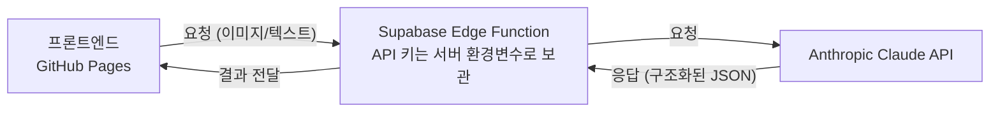

# DueBoard — 외주 프로젝트 태스크 통합 관리

> 서비스기획 · UI/UX 과정 프로젝트 기획서
> 작성자: 김서경 · 최종 수정일: 2026-08-13

---

## 1. 배경

- 기존에 운영 중인 개인용 웹앱 **Lit**(GitHub Pages 배포, Supabase 백엔드)이 있지만,
  이번 과제는 Lit에 바로 합치지 않고 **PM/UXUI 아카데미 과제로 진행하는 독립적인
  프로토타입**으로 만든다. 실제로 써보고 마음에 들면 추후 Lit 통합을 검토한다.
- 디자인 톤도 Lit의 기존 퍼플 톤을 따르지 않고, **이 과제만의 독립적인 디자인**으로
  진행한다.

## 2. 핵심 문제 (Pain Point)

클라이언트가 프로젝트마다 정리된 스프레드시트(구분/콘텐츠/사이즈/마감일/비고 컬럼)를
준다. 이 스프레드시트가 프로젝트별로 여러 개 흩어져 있어서, 일정을 확인하려면 여러
시트를 오가야 하는 게 번거롭다.

> **여러 프로젝트의 일정을 한곳에서 통합해서 보고 싶다.**

## 3. MVP 기능 범위

리더 피드백에 따라 "컨셉 방향 도출" 같은 부가 기능은 제외하고, 아래 하나에 집중한다.

> **클라이언트가 주는 정보(캡처 이미지 또는 텍스트)를 입력하면, 구조화된 작업
> 리스트로 자동 정리해주는 기능**

### 입력 방식
1. **이미지 붙여넣기 (Ctrl+V)** — 스프레드시트 캡처를 그대로 붙여넣기. 최우선 입력 방식.
2. **텍스트 붙여넣기** — 엑셀/시트에서 복사한 탭 구분 텍스트도 지원.
3. **수동 폼 수정** — 위 두 방식으로 자동 채워진 폼을 사용자가 훑어보고 틀린 칸만
   직접 고치는 검수 단계. ("자동 초안 + 수동 검수" 구조 — 완전 자동도, 완전 수동도 아님)

## 4. 데이터 구조

**프로젝트 레벨**
- 프로젝트명, 클라이언트명
- 클라이언트 태그 (`#국가기관` `#대기업` `#엔터테인먼트` `#에이전시` 등)
- 프로젝트 태그 (`#현장제작물` `#온라인콘텐츠` `#인쇄물` `#캠페인` 등)
- 정산 상태: `제작중` → `제작완료` → `정산완료` (3단계, **수동 변경**)
- 진행률(%): 완료 태스크 ÷ 전체 태스크로 **자동 계산**

**태스크 레벨**
- 구분 / 콘텐츠 / 사이즈 / 예정일(게시일) / 상태 / 비고 — 클라이언트 시트 컬럼 구조 그대로
- 같은 산출물의 여러 차례 수정은 별도 태스크로 만들지 않고, **하나의 태스크 안에
  수정 이력으로 누적**(예: "3차 수정 · 08.09"). 수정 이력을 추가하면 해당 태스크는
  다시 미완료로 집계된다.
- 예정일(planned)과 실제 완료일(actual)을 별도로 기록 — 둘이 다르면 "지연"으로 처리.

## 5. 긴급도 로직

- 프로젝트 카드의 긴급도(D-day)는 **프로젝트 전체 마감일이 아니라, 그 프로젝트에서
  다음으로 게시해야 할 콘텐츠의 예정일** 기준.
- 표시는 **카드 배경색이 아니라 테두리 색**으로 구분 (배경 채움은 지저분해 보인다는
  피드백 반영):
  - 테두리 빨강: 다음 게시일 D-3 이하
  - 테두리 노랑/황토: D-7 이하
  - 기본: 여유
- 전체 배경색은 **노란기 없는 옅은 회색**을 사용한다.

## 6. 화면 구성

### 6-1. 첫 화면 = 달력
리스트가 아니라 캘린더 뷰. 날짜 아래 프로젝트별 색상 마커를 표시한다.

**마커 인코딩** — 색상 = 프로젝트 구분(식별), 모양+채움 = 상태

| | 미완료 | 완료 |
|---|---|---|
| **원 (정상)** | 빈 원 — 예정, 진행 전 | 채운 원 — 제때 완료 |
| **세모 (지연)** | 빈 세모 — 예정일 지났는데 미완료 | 채운 세모 — 늦게 완료 |

날짜 클릭 → 하단에 그날 관련 작업 상세 패널. 예정일과 실제 완료일이 다르면 그
차이를 텍스트로 비교 표시한다. (예: "예정 8/6 → 실제 8/8 완료")

### 6-2. 달력 아래 = 프로젝트 리스트 (아코디언)
카드 클릭 시 펼쳐지며 태스크 표(NO/구분/콘텐츠/사이즈/예정일/상태/비고)가 나온다.
카드에는 프로젝트명·클라이언트·태그·진행률 바·정산 상태·다음 게시 항목과 D-day
배지가 함께 표시된다.

### 6-3. 붙여넣기로 추가 (핵심 MVP 플로우)
1. 붙여넣기 대기 화면 — 캡처 이미지 또는 표 텍스트를 붙여넣는다.
2. 자동 파싱 — 이미지/텍스트에서 구조를 인식해 프로젝트 정보 + 태스크 표 초안을
   만든다.
3. 검수/수정 — 자동으로 채워진 내용을 훑어보고 틀린 칸만 고친 뒤 저장한다. 기존
   프로젝트에 태스크를 추가할지, 새 프로젝트로 만들지 선택할 수 있다.

## 7. 기술 아키텍처 — 실제 서비스로 갈 때 중요한 점

**AI로 이미지/텍스트를 파싱해서 폼에 자동 채우는 기능을 실제 배포(GitHub Pages)에
붙이려면, API 키를 프론트엔드 코드에 그대로 노출하면 안 된다.** GitHub Pages는
정적 호스팅이라 키를 숨길 방법이 없고, 개발자도구로 누구나 키를 탈취할 수 있다.

**해결책**: 이미 Lit이 Supabase를 백엔드로 쓰고 있으므로, **Supabase Edge
Function**을 프록시로 세운다.

- Claude API는 Anthropic 콘솔(console.anthropic.com)에서 별도 발급하며 **종량제
  과금**(claude.ai 구독과 별개)이다.
- 프론트엔드는 API 키를 직접 들고 있으면 안 되며, 항상 Edge Function을 통해서만
  호출한다.

## 8. 프로토타입 구현 범위 (현 단계)

Supabase 프로젝트·Anthropic API 키가 아직 없는 단계이므로, **UI/UX 검증을 위한
목업 우선**으로 아래와 같이 구현했다.

| 입력 방식 | 프로토타입 구현 | 실제 서비스 전환 시 |
|---|---|---|
| **텍스트 붙여넣기** | 실제로 동작하는 규칙 기반 파서 — 탭/콤마 구분 표, 헤더 인식(구분/콘텐츠/사이즈/예정일/비고), 여러 날짜 형식(YYYY-MM-DD, M/D, "M월 D일") 정규화 | 그대로 사용 가능 (AI 없이도 동작) 또는 Claude로 정확도 보완 |
| **이미지 붙여넣기** | 🧪 데모 모드 — 실제 이미지 내용은 읽지 않고, 예시 데이터로 폼을 자동완성. 붙여넣은 이미지 미리보기는 실제로 표시됨 | 위 7번 아키텍처(Supabase Edge Function → Claude API)로 교체 |

이 구분은 화면 안에서도 사용자에게 투명하게 표시된다 (이미지 파싱 결과 상단에
"프로토타입 데모" 안내 박스).

## 9. 사용 기술 (프로토타입)

- 순수 HTML/CSS/JavaScript, 빌드 도구 없이 단일 파일로 동작
- 데이터는 브라우저 `localStorage`에 저장 — 프로젝트/태스크 등록, 완료 처리, 정산
  상태 변경, 수정 이력 추가가 실제로 동작하는 **작동 프로토타입**
- 실제 화면은 저장소 루트의 `index.html` 참고

## 10. 향후 확장 (과제 범위 밖)

- Supabase Edge Function + Claude API 실연동 (위 7번 아키텍처)
- 이미지 다중 인식(한 캡처에 여러 프로젝트가 섞여 있는 경우 자동 분리)
- 클라이언트별 커뮤니케이션 로그 통합
- Lit 통합 검토 (반응이 좋을 경우)
